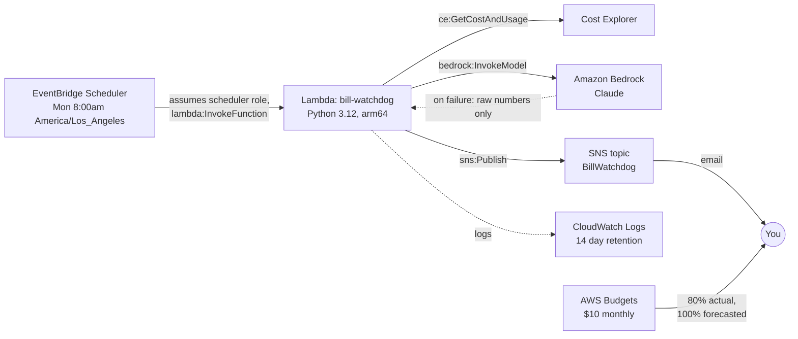

# Cloud Bill Watchdog

A small serverless app that emails you a plain English summary of your AWS spend every Monday morning, written by Claude on Amazon Bedrock. Everything is defined in Terraform.

## What it does

Every Monday at 8:00am Pacific:

1. **EventBridge Scheduler** invokes a Python Lambda function.
2. The Lambda makes **one** Cost Explorer request for daily spend grouped by service, covering the last 14 days and the current month, and splits it into *this week*, *last week*, and *month to date*.
3. It builds a report: totals, change per service, services that are new this week, and whether you passed your weekly limit (which turns the subject line into ALERT).
4. It sends that report to **Amazon Bedrock** (Claude) through the Converse API and asks for a short summary.
5. It publishes the summary plus a raw numbers table to an **SNS** topic, which emails you.

If Bedrock fails for any reason (throttling, access denied, empty answer), the email still goes out with the raw numbers and a note that the AI summary was unavailable. A separate **AWS Budgets** budget acts as an independent safety net that does not rely on any of this code.

Example email:

```
Subject: Weekly AWS spend: $3.42 this week (+1.10 vs last week)

Worth a look. You spent $3.42 this week versus $2.32 last week, and $9.80
month to date. Amazon EC2 rose 53 percent, likely an instance left running
over the weekend. Stop or schedule it to save about $1 a week.

RAW NUMBERS

Week ending 2026-10-19 (end exclusive)
This week: $3.42   Last week: $2.32   Change: $+1.10
Month to date: $9.80   Weekly limit: $5.00

Service                                           Last      This    Change
Amazon Elastic Compute Cloud - Compute            1.80      2.75     +0.95
...
```

## Architecture



## Repo layout

| Path | Purpose |
| --- | --- |
| `src/lambda_function.py` | Lambda code: fetch, compare, summarize, publish |
| `infra/providers.tf` | Terraform and provider versions, AWS profile and region |
| `infra/variables.tf` | Inputs (region, profile, email, model, limits) |
| `infra/main.tf` | All AWS resources, each with a comment explaining it |
| `infra/outputs.tf` | Names and ARNs you need after deploy |
| `infra/terraform.tfvars.example` | Template for your private `terraform.tfvars` |
| `tests/` | pytest unit tests using botocore Stubber and mocks (no real AWS calls) |
| `docs/original/` | The first hand written version of the Lambda and its IAM policy, kept for comparison. Terraform now generates a tighter policy. |

## AWS resources

| Resource | Why it is here |
| --- | --- |
| SNS topic `BillWatchdog` + email subscription | Delivers the report. Email subscriptions must be confirmed by clicking a link. |
| IAM role `bill-watchdog-lambda` | Identity the Lambda runs as. Gets `AWSLambdaBasicExecutionRole` for logging plus an inline least privilege policy. |
| Lambda `bill-watchdog` | Runs the code. 128 MB, 60 second timeout, Graviton (arm64). |
| CloudWatch log group `/aws/lambda/bill-watchdog` | Created by Terraform so retention can be capped at 14 days. |
| EventBridge Scheduler schedule + IAM role | Timezone aware cron. Its role can invoke only this one function. |
| AWS Budgets `bill-watchdog-monthly` | $10 monthly budget, alerts at 80% actual and 100% forecasted. |

## Prerequisites (do these manually)

These are account level or one time console steps, so they are intentionally not automated.

1. **MFA on the root user.** Then stop using root for daily work.
2. **An admin user through IAM Identity Center**, and an AWS CLI profile for it:
   ```powershell
   aws configure sso            # creates a named profile
   aws sso login --profile <your-profile>
   ```
3. **Cost Explorer enabled** (Billing and Cost Management console, Cost Explorer, Launch). Data can take up to 24 hours to appear the first time.
4. **Bedrock model access** for an Anthropic Claude model in the region you deploy to (Bedrock console, Model access). Note the **model ID** or the **cross region inference profile ID** (for example one starting with `us.anthropic.`). Newer Claude models are usually only callable through an inference profile.
5. Tools: [Terraform](https://developer.hashicorp.com/terraform/install) 1.6 or newer, [AWS CLI v2](https://aws.amazon.com/cli/), Python 3.12 or newer (for tests).

## Setup and deploy

```powershell
git clone https://github.com/elephantebae/cloud-bill-watchdog.git
cd cloud-bill-watchdog

# 1. Run the unit tests (no AWS calls, no credentials needed)
python -m pip install -r requirements-dev.txt
python -m pytest

# 2. Configure your private variables
cd infra
Copy-Item terraform.tfvars.example terraform.tfvars   # macOS/Linux: cp
# edit terraform.tfvars: aws_profile, alert_email, model_id, aws_region

# 3. Deploy
aws sso login --profile <your-profile>
terraform init
terraform fmt -check
terraform validate
terraform plan -out tfplan
terraform apply tfplan
```

After `apply`, **check your inbox and confirm the SNS subscription**. Until you do, SNS drops the messages.

## Test it in AWS

```powershell
# Trigger a report now instead of waiting for Monday
aws lambda invoke --function-name bill-watchdog --profile <your-profile> --region <your-region> response.json
Get-Content response.json

# Watch the logs (shows whether the AI summary or the fallback was used)
aws logs tail /aws/lambda/bill-watchdog --since 15m --profile <your-profile> --region <your-region>

# Confirm the schedule
aws scheduler get-schedule --name bill-watchdog-weekly --profile <your-profile> --region <your-region>
```

To exercise the fallback path, set `model_id` to a model you have not enabled, `apply`, invoke again, and you should get the raw numbers email.

## Cost estimate

Roughly **$0.05 to $0.25 per month** for a personal account.

| Service | Usage | Approx. monthly cost |
| --- | --- | --- |
| Cost Explorer API | about 4 requests (one per run) at $0.01 each | $0.04 |
| Bedrock (Claude) | about 4 calls, around 1,500 input and 200 output tokens each | under $0.01 (Haiku class) to about $0.10 (Sonnet class) |
| Lambda | 4 short runs | $0 (free tier) |
| EventBridge Scheduler | 4 invocations | $0 (free tier) |
| SNS email | 4 emails | $0 (first 1,000 free) |
| CloudWatch Logs | a few KB, 14 day retention | about $0 |
| AWS Budgets | 1 budget with email alerts | $0 (alert only budgets are free; only budgets with automated actions are billed after the first two) |

Running `aws lambda invoke` many times while testing adds $0.01 per run for Cost Explorer.

## Security notes

* **No secrets in the repo.** Terraform authenticates with your AWS CLI profile. `terraform.tfvars`, state files, and build zips are gitignored. The account ID is read at plan time, never written down.
* **Least privilege.** The Lambda can read costs, publish to *this* topic only, and invoke *this* model (and its inference profile) only. `ce:GetCostAndUsage` needs `Resource: "*"` because Cost Explorer has no resource level permissions.
* **Separate roles.** The scheduler has its own role that can only invoke this function, with an `aws:SourceAccount` condition to prevent the confused deputy problem.
* **Short log retention.** 14 days keeps cost data from lingering in logs.
* **State contains your email.** Terraform state stores variable values in plain text. Keep it local (gitignored) or move to an encrypted S3 backend.
* **Prompt contents.** Only aggregated per service totals are sent to Bedrock. Bedrock does not use prompts to train models.

## Future upgrades

* Remote state in S3 with native S3 state locking, plus encryption.
* GitHub Actions: pytest, `terraform fmt -check`, `validate`, `tflint`, and `checkov` on every pull request, with OIDC federation for a plan job (no stored keys).
* Anomaly detection: add AWS Cost Anomaly Detection, or compare against a rolling 4 week average instead of only last week.
* Encrypt the SNS topic with a customer managed KMS key.
* Dead letter queue and a CloudWatch alarm on Lambda errors so a failed run is never silent.
* Post to Slack or Microsoft Teams through AWS Chatbot in addition to email.
* Break down by linked account or cost allocation tag for multi account setups.
